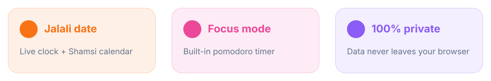

<div align="center">


<br>


### یه صفحه‌ی شروع آروم و خوشگل با تاریخ شمسی 🌅

</div>

---

<div dir="rtl">

## ✨ این چیه؟

هر بار تب جدید باز می‌کنی چی می‌بینی؟ یه صفحه‌ی خالی یا یه سری تبلیغ؟ 😒

**«روز»** یه صفحه‌ی شروعِ مینیمال و فارسیه که تاریخ شمسی، ساعت، تایمر تمرکز و لیست کارهات رو یه‌جا بهت نشون می‌ده. فقط **یه فایل HTML** هست. نه نصب می‌خواد، نه اکانت، نه سرور.



## 🎁 چی توشه؟

- 🕐 **ساعت زنده** با ارقام فارسی
- 📅 **تاریخ شمسی** (مثلا «چهارشنبه ۲۰ آبان ۱۴۰۵») بدون هیچ کتابخونه‌ای
- 👋 **سلام هوشمند** که بسته به ساعت روز عوض می‌شه
- 🍅 **پومودورو** با حالت‌های ۲۵ و ۵ دقیقه و صدای زنگ آخرش
- ✅ **لیست کار** که بعد از بستن مرورگر هم می‌مونه
- 🔗 **لینک‌های سریع** که خودت اضافه و حذف می‌کنی
- 🔎 **جستجوی سریع** با گوگل
- 🌈 **پس‌زمینه‌ی گرادیانی** که آروم تکون می‌خوره

## 🚀 شروع سریع

### روش ۱: همین الان امتحانش کن

```bash
git clone https://github.com/CyberLoop-dev/rooz.git
cd rooz
# فایل index.html رو تو مرورگر باز کن. تموم! 🎉
```

### روش ۲: بکنش صفحه‌ی اصلی مرورگر

1. فایل `index.html` رو یه جای ثابت نگه دار
2. تو تنظیمات مرورگر، «Home page» رو روی آدرس فایل بذار (مثلا `file:///home/you/rooz/index.html`)
3. اگه می‌خوای تب جدید هم همین باشه، یکی از افزونه‌های «New Tab Override» رو نصب کن و آدرس رو بهش بده

### روش ۳: آنلاین (GitHub Pages)

`Settings` ← `Pages` ← برنچ `main` رو انتخاب کن. بعد از یه دقیقه سایتت اینجاست:

```text
https://CyberLoop-dev.github.io/rooz/
```

## 🎮 راهنمای کار با صفحه

| کار | چطوری |
|---|---|
| تیک زدن یه کار | روی متنش کلیک کن |
| حذف یه کار | دکمه‌ی ✕ |
| حذف یه لینک | روش راست‌کلیک کن |
| لینک جدید | دکمه‌ی «+ افزودن» |

## 🔒 حریم خصوصی

همه‌ی داده‌ها (کارها و لینک‌ها) فقط تو `localStorage` مرورگر خودت ذخیره می‌شن. هیچ درخواستی به سرور من یا کس دیگه‌ای فرستاده نمی‌شه. نه آنالیتیکس، نه کوکی، نه هیچی.

## 🎨 شخصی‌سازی

رنگ‌ها همه تو چند خط اول CSS هستن:

```css
:root{--bg1:#1e1b4b;--bg2:#831843;--bg3:#7c2d12;--acc:#fb923c}
```

عوضشون کن و تم خودت رو بساز. 💅

## 🗺️ نقشه‌ی راه

- [ ] تم روشن
- [ ] ایجاد یادداشت سریع
- [ ] نمایش مناسبت‌های تقویم شمسی
- [ ] بک‌آپ و ریستور لینک‌ها

## 💜 حمایت

اگه از «روز» خوشت اومد، یه ⭐ بده و به دوستات هم بگو!

License: [MIT](LICENSE)

</div>
